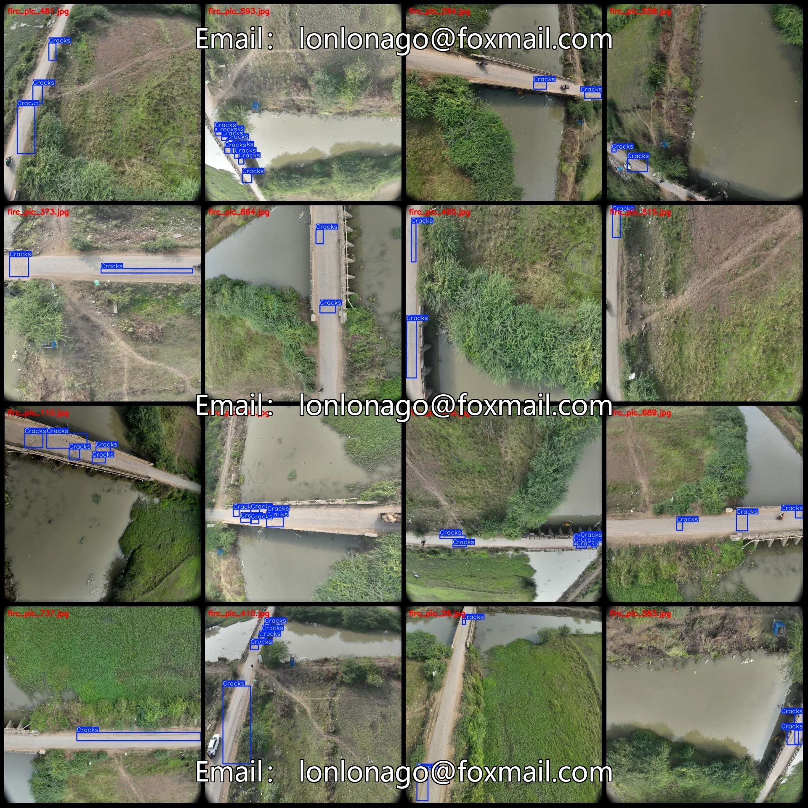
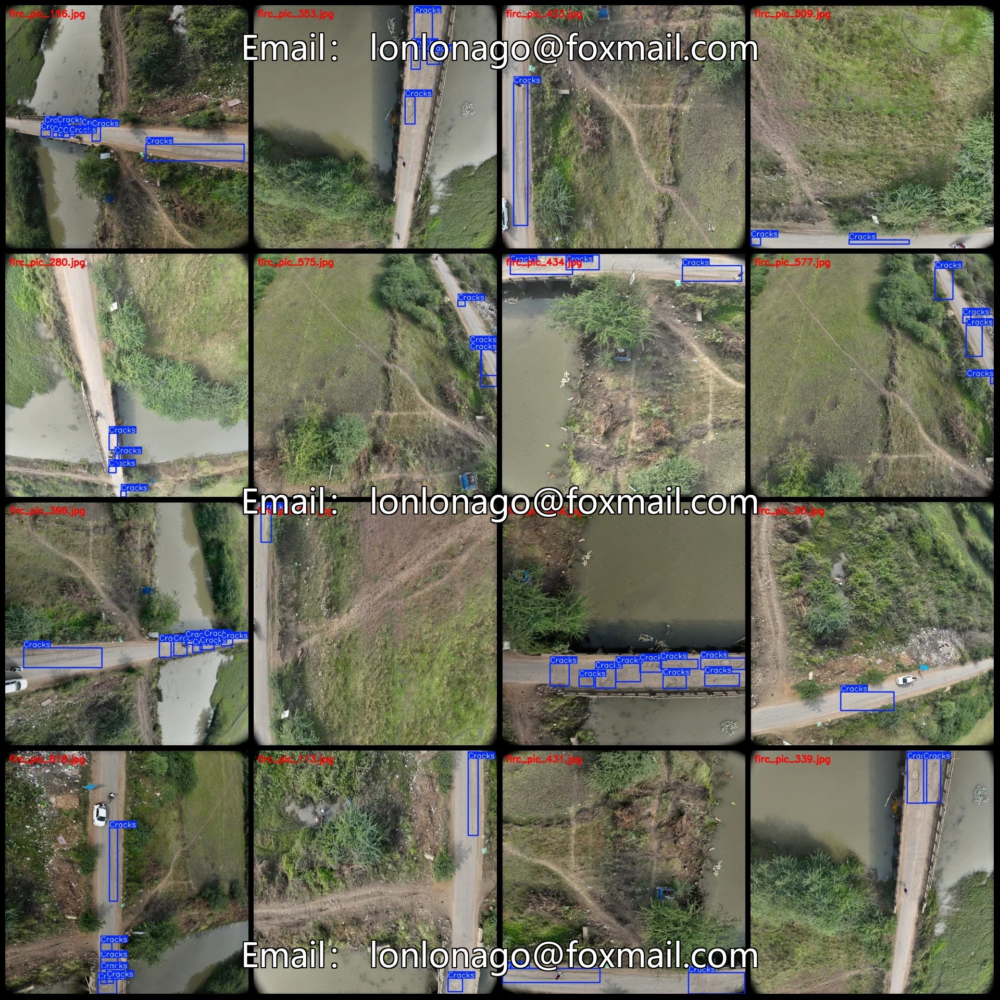
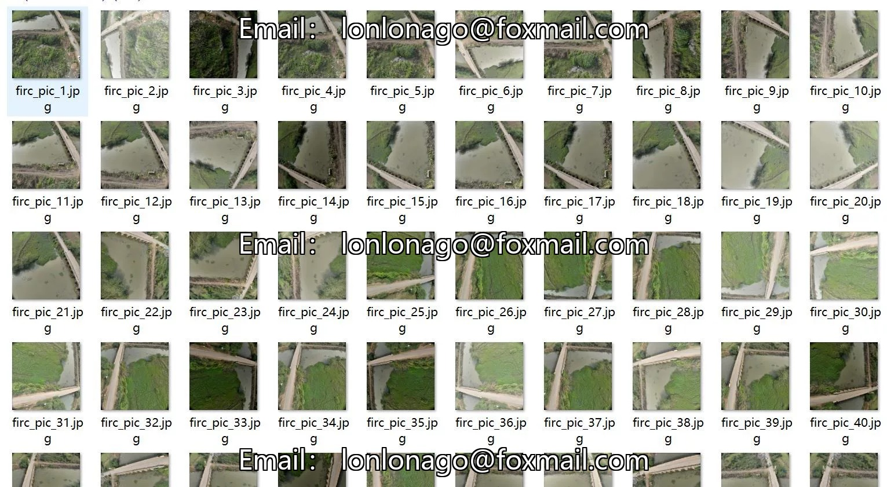
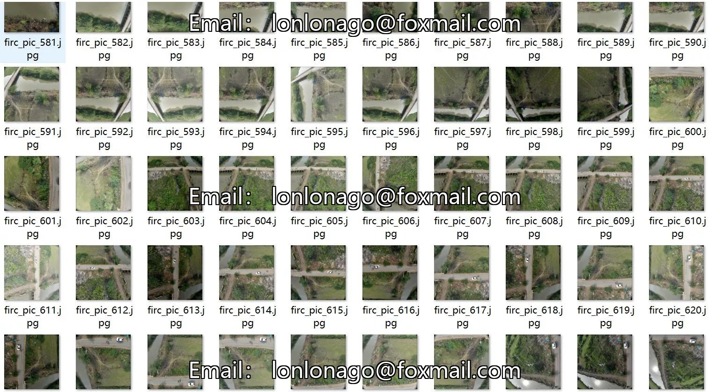
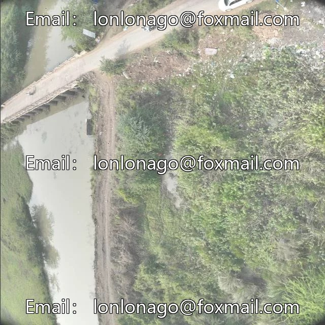
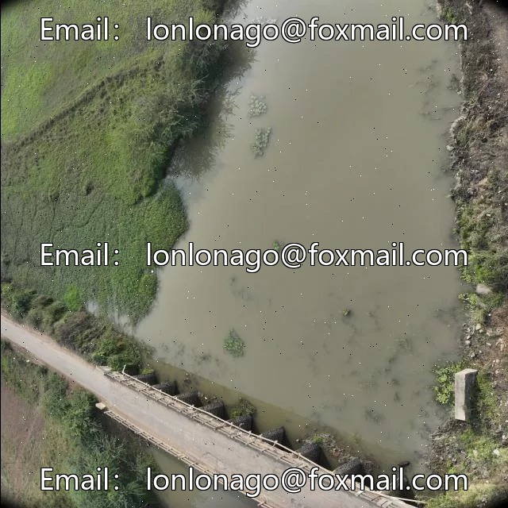
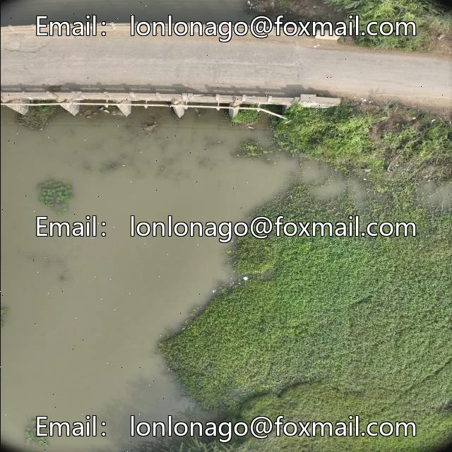

# Drone-view aerial photography road crack defect detection dataset VOC+YOLO format 74

## Body

Drone-Viewpoint Aerial Photography Road Crack Defect Detection Dataset VOC+YOLO Format: 748 Images, 1 Category with Enhanced
Warm Reminder: Due to the dataset's replicability, please confirm compliance before purchasing.
Note: The dataset contains a large number of enhanced images, approximately 80-100 of which are original images, with the rest being enhanced versions.
Dataset Format: Pascal VOC format + YOLO format (txt file without segmentation paths, only containing jpg images and corresponding VOC format xml files and yolo format txt files)
Number of Images (Total jpg files): 748
Number of Annotations (Total xml files): 748
Number of Annotations (Total txt files): 748
Number of Annotation Categories: 1

Annotation Category Name: ["Cracks
Number of boxes and image counts per category
Cracks = 3315, Image Count = 748
Total Boxes: 3315
Image Resolution: 640x640
Annotation Tool: labelImg
Annotation Rules: Draw a box around the category
Important Notice: The dataset does not have split into training validation test sets. Please divide them yourself.
Special Statement: This dataset does not guarantee the accuracy of the trained model or weight files.

## Images

## Payment

Here is a pay link on Stripe ( https://buy.stripe.com/3cs8yP7sY87d0vu9AB ). Please contact me lonlonago@foxmail.com after funding $89, and I will send you a complete data files , thank you!

